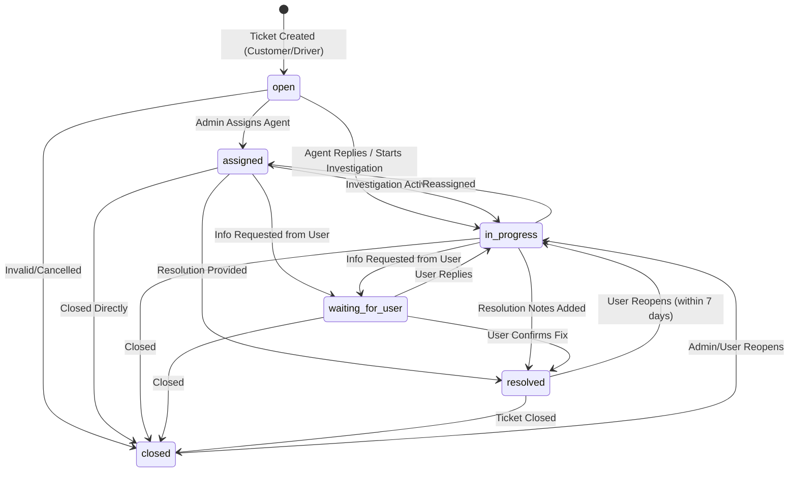

# GoDelivo Support & Complaint Backend Workflow Guide

This document details the backend workflows, data flows, security isolation, and integration mechanisms of the GoDelivo Support and Complaint System.

---

## 1. Ticket Lifecycle & State Machine



### Transition Validation Rules

1. **`open`:**
   - Permitted next states: `assigned`, `in_progress`, `closed`.
   - Cannot jump directly to `resolved` without entering `in_progress`.
2. **`waiting_for_user`:**
   - Any public message sent by the ticket creator (`CUSTOMER` or `DRIVER`) automatically shifts the status back to `in_progress`.
3. **`resolved`:**
   - Requires `resolutionNotes`, `resolvedBy`, and `resolvedAt` timestamps.
   - Customers and Drivers can reopen resolved tickets within the configured `reopenWindowDays` (default: 7 days) if the issue persists.
4. **`closed`:**
   - Final state. Reopening requires a valid reason string.

---

## 2. Public Messages vs Private Internal Notes (Strict Isolation)

To protect platform security and internal dispute deliberations, the backend implements server-side message isolation:

```
[ Incoming Request ]
        │
        ▼
[ Authentication Middleware ] ──► Extracts User Role ('customer', 'driver', 'admin')
        │
        ▼
[ Support Controller: getTicket / getTickets / getMyTickets ]
        │
        ├── If Role == 'admin':
        │      └── Returns full Ticket model (public messages + internal notes + full audit trail)
        │
        └── If Role in ['customer', 'driver']:
               └── Invokes ticket.toPublicJSON():
                     ├── Strips all messages with `isInternal: true`
                     └── Strips all audit entries with `isInternal: true`
```

### Real-Time Socket.IO Isolation
* **Public Messages:** Broadcast to `ticket-${ticketId}` and `admin-room`.
* **Private Internal Notes:** Broadcast **strictly** to `admin-room`. Non-admin sockets in `ticket-${ticketId}` never receive internal note payloads.

---

## 3. Financial Safety Guarantee

When a complaint involves:
* Ride fare disputes
* Loading/unloading waiting charge calculations
* Cash settlement or commission disputes
* Wallet balance or withdrawal requests

The backend enforces strict non-interference:
1. **Audit-Only Access:** The endpoint `GET /api/support/tickets/:id/related-ride` provides complete read-only visibility into the ride's base fare, waiting charge calculation breakdown, payment records, and driver earnings.
2. **No Automatic Financial Mutation:** Creating, replying to, resolving, or closing a complaint will **never** alter MongoDB balances, deduct commissions, or generate refund transactions automatically.
3. **Authorized Adjustments:** Any approved financial adjustment or refund must proceed through existing, authorized financial services (`/api/wallet/`, `/api/payments/`) utilizing standard transaction and idempotency controls.

---

## 4. Real-Time Socket.IO Event Map (`/support` Namespace)

| Event Name | Direction | Room | Description |
| :--- | :--- | :--- | :--- |
| `join-ticket` | Client $\to$ Server | N/A | Subscribes socket to `ticket-${ticketId}` |
| `leave-ticket` | Client $\to$ Server | N/A | Unsubscribes socket from `ticket-${ticketId}` |
| `join-admin` | Client $\to$ Server | N/A | Subscribes authenticated admin to `admin-room` |
| `join-user` | Client $\to$ Server | N/A | Subscribes user to `user-${userId}` |
| `ticket:created` | Server $\to$ Client | `admin-room` | Emitted when a new ticket is submitted |
| `ticket:message` | Server $\to$ Client | `ticket-${ticketId}` | Emitted when a public message is added |
| `ticket:internal-note` | Server $\to$ Client | `admin-room` | Emitted when an internal note is added |
| `ticket:assigned` | Server $\to$ Client | `admin-room` | Emitted when ticket is assigned/reassigned |
| `ticket:status-changed` | Server $\to$ Client | `ticket-${ticketId}` | Emitted on status transition |
| `ticket:resolved` | Server $\to$ Client | `ticket-${ticketId}` | Emitted when ticket is resolved |
| `ticket:reopened` | Server $\to$ Client | `ticket-${ticketId}` | Emitted when ticket is reopened |
| `user-typing` | Server $\to$ Client | `ticket-${ticketId}` | Real-time typing indicator |
| `user-stop-typing` | Server $\to$ Client | `ticket-${ticketId}` | Real-time stop typing indicator |
| `message-read` | Server $\to$ Client | `ticket-${ticketId}` | Message read receipt indicator |
